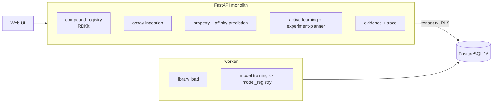

# Intelligent Pharmaceutical Drug Discovery Workspace

For a discovery team: it registers compounds as real structures (RDKit canonical SMILES, InChIKey, descriptors), holds assay results
with provenance, trains an affinity model whose uncertainty is checked rather than asserted, picks the next assay plate under a
budget, folds the results back in as a new model version, and lets a chemist trace any recommendation to measured neighbours,
the substructures behind it and the model version that made it.

Built from blueprint 7 of "Advanced Engineering Build Book, Volume III" as a **vertical slice**: the demo scenario end to end,
with the platform parts real and the rest listed under [Not built](#not-built-and-why).

**The library, the target and every measurement come from a simulator in this repository. The molecules are real structures handled
by RDKit; the target and its binding rule are invented. Research decision support on synthetic data, nothing clinical.**

## Run it

```bash
docker compose up --build        # migrates, seeds, serves http://localhost:8217/ui/ with one worker
docker compose run --rm test     # 13 tests against a throwaway database (about 70 s; the models train several times)
```

Open http://localhost:8217/ui/ and press **Run all steps** (about 40 seconds; each model version takes about 10), or `make bootstrap demo`.
Demo tokens (local only): `lab-lead-demo`, `lab-scientist-demo`, `lab-viewer-demo`. Run `make reset` before a second demo run.

## The demo, step by step

1. 10,000 molecules built from cores, linkers and substituents (5,931 in stock, 4,069 to make), one invented kinase target, 300 compounds measured in two replicates (600 values, some below the assay floor). Model v1: five gradient-boosted regressors on Morgan fingerprints and seven descriptors. Held out: RMSE 0.56 against 0.71 for the nearest-neighbour baseline; 93% inside the 90% band after rescaling. Against the hidden truth on all 9,700 unmeasured compounds: RMSE 0.61, 80% inside the band, and all 96 best-predicted compounds are really active.
2. A chemist registers three SMILES: a new aryl sulfonamide (added), a structure already in the library (ignored by InChIKey), and `C1CC((` (refused). Properties are computed by RDKit, not predicted.
3. Affinity for the new compound and two library compounds: a prediction, a 90% band, and the three most similar measured compounds with their values.
4. The next plate: upper-confidence scores with a diversity rule under a budget of 200 (compounds to make cost 5). 72 compounds across 6 scaffolds; pure exploitation would take 68 from 3 scaffolds; random 96 from 10. The hidden truth: 64, 68 and 7 actives respectively. The scientist who proposed it is refused approval; a lead approves.
5. The plate comes back (simulated: hidden truth plus assay noise): 63 actives of 72, prediction error 0.72 on the plate. Two manual values are uploaded, one twice. Model v2 trains on 373 compounds; v1 is retired.
6. The top compound traced: predicted 8.63 (7.6 to 9.67) by v2, measured on the plate, hidden truth 7.98; the five nearest measured compounds; the substructures that move the prediction (the aryl amine +2.3, the sulfonamide +0.7). The target's evidence page: 746 values on 9 plates, two model versions with their calibration, and no activity cliffs meeting the rule among the measured pairs.
7. The audit log.

## Architecture



| Piece | How it works |
|---|---|
| Simulator (`dd/world.py`) | Cores, linkers and substituents combined into SMILES, canonicalised and deduplicated by RDKit; a hidden rule gives each compound a pIC50 from its substructures (sulfonamide, aryl amine, trifluoromethyl, acid, indole, piperidine, one interaction), size and lipophilicity, plus noise. An assay adds noise and censors below 4.5. |
| Affinity model | Five gradient-boosted regressors on bootstrap resamples; their spread is rescaled by one factor fitted on a held-out fifth so the 90% band holds there. Trained on everything measured, reported on a fixed held-out split against a Tanimoto k-nearest-neighbour baseline. Each version is a row in `model_registry` with its artefact. |
| Plate selection | Score = mean + kappa x uncertainty; take the best not within Tanimoto 0.7 of anything already picked; stop at the plate size or budget. Exploitation and random are computed beside it, and the hidden truth scores all three. |
| Trace | Nearest measured neighbours by Tanimoto; the effect of each fingerprint bit, found by switching it off; the atom environment each bit stands for in that molecule. |
| Platform | Row-level security per lab, Postgres job queue, Idempotency-Key replay, hash-chained audit log, `/metrics`. |

## Data model

`migrations/002_discovery.sql` follows the blueprint (targets, compounds, assays, measurements, predictions, experiments,
experiment_candidates); additions are marked `(+)`: libraries, descriptors and cost on compounds, plates and provenance on
measurements, the proposing model version and approver on experiments. Model artefacts live in core's `model_registry`.

## API

| Method | Endpoint | Purpose |
|---|---|---|
| POST | `/v1/compounds` | Register SMILES: canonical, deduplicated, descriptors |
| POST | `/v1/assays/{id}/measurements` | Upload a plate; duplicates ignored |
| POST | `/v1/predict/properties` | RDKit descriptors and Lipinski |
| POST | `/v1/predict/target-affinity` | pIC50 with a band, the model version, nearest measured neighbours |
| POST | `/v1/active-learning/batch` | Select a plate; compared with exploitation and random |
| POST | `/v1/experiments/propose` | Store the selection as an experiment with rationale |
| GET | `/v1/targets/{id}/evidence` | Measurements, model versions, candidates, activity cliffs |
| POST | `/v1/models/train` | (+) 202 + job: a new model version with its report |
| POST | `/v1/experiments/{id}/approve` | (+) A lead approves; not the proposer |
| GET | `/v1/compounds/{id}/trace` | (+) The recommendation's evidence chain |
| POST | `/v1/library:load` | (+) 202 + job: the synthetic library |

Contract: [`docs/openapi.json`](docs/openapi.json). `POST /v1/experiments/{id}/results:simulate` exists for the demo and says so.

## Measured

[`docs/evaluation.md`](docs/evaluation.md) (`python -m dd.evaluate`, three libraries the demo never uses) and
[`docs/performance.md`](docs/performance.md).

| Component | Result | Baseline |
|---|---|---|
| Affinity RMSE on 9,700 unmeasured compounds | 0.62 to 0.64 | nearest neighbours: 0.85 to 0.87; the noise floor is about 0.45 |
| Inside the 90% band | 83% to 91% after rescaling | the raw ensemble spread: well under 60% |
| Uncertainty predicts which compounds are wrong | rank correlation 0.10 to 0.13 | |
| Actives found on a plate of up to 96 | upper confidence + diversity: 73 | exploit: 83; random: 8 |
| Model RMSE after folding the plate in | 0.629 | exploit: 0.628; random: 0.606 |

Three things these numbers say plainly. The model beats the baseline, and its band is honest only because one scale factor was
fitted to make it so; the raw ensemble spread was two to three times too narrow, and the uncertainty still says little about
which compounds will be wrong. On this generator the active-learning selection did not earn its reputation: exploitation found
more actives and random taught the model more. The hidden rule is additive and the fingerprints were made to find it, so these
numbers are a statement about the generator, not about a real target.

## The hardest tradeoff

Actives now against a better model. The upper-confidence rule is supposed to buy both, and on this generator it bought neither:
the uncertain compounds it reached for were the expensive ones to make and, once measured, told the model little it did not
know. Exploitation filled the plate from one series and found 83 actives of 84; random found 8 and was the only choice that
lowered the model's error. The system does not resolve this. It exposes the knob (kappa), shows all three selections with the
hidden truth's score for each, and leaves the programme decision to the lead who approves the plate.

## Threat model (summary)

| Threat | Mitigation here | Gap |
|---|---|---|
| A plate made on one person's say-so | Experiments are proposals; a lead approves, and the proposer cannot | One approval |
| A prediction trusted beyond its evidence | Every prediction carries a band whose coverage is measured, the model version, and the nearest measured compounds | The band is scaled, not learned, and still under 90% |
| Duplicate or malformed registrations | Canonicalisation and InChIKey deduplication; unparseable SMILES refused; replicates keyed by compound, replicate and plate | No stereochemistry or salt handling |
| Losing which model made a recommendation | The version is stored with every prediction and every experiment; versions are retired, never deleted | |
| One lab seeing another's compounds | Row-level security on every table; tested through the API and directly in the database | |

## Not built, and why

- **Real data** (ChEMBL, PubChem, BindingDB, Tox21): the library is generated; some of its structures are chemically implausible (a bare sulfonyl amide appears), which RDKit accepts and the rule does not care about.
- **GNN/MPNN and multi-task ADMET models**: a gradient-boosted ensemble on fingerprints is the whole model layer.
- **Docking adapter and literature RAG**: not started; no language model anywhere.
- **A target knowledge graph**: one target, one assay.
- **Bayesian optimisation proper**: upper confidence with a Tanimoto diversity rule stands in.
- **Kafka, Redis, OpenTelemetry, Grafana, MLflow, Terraform, CI, SSO, a Next.js front end**: not needed to prove the slice; no cloud account used.

## Commercial sketch

Buyer: biotech and discovery teams, CROs. Pricing shape from the blueprint: seats plus compute, private deployment, training
credits. Research decision support, not clinical decision-making.

## Layout

```
core/        platform kit: db + RLS, jobs, audit chain, HTTP, scenario runner, load test
dd/          world (library, rule, assay), engine (model, calibration, selection, trace), api, seed, evaluate
migrations/  forward-only SQL          web/   UI, scenario.json, demo.json (recorded run)
tests/       13 tests                  docs/  evaluation.md, performance.md, openapi.json
```
